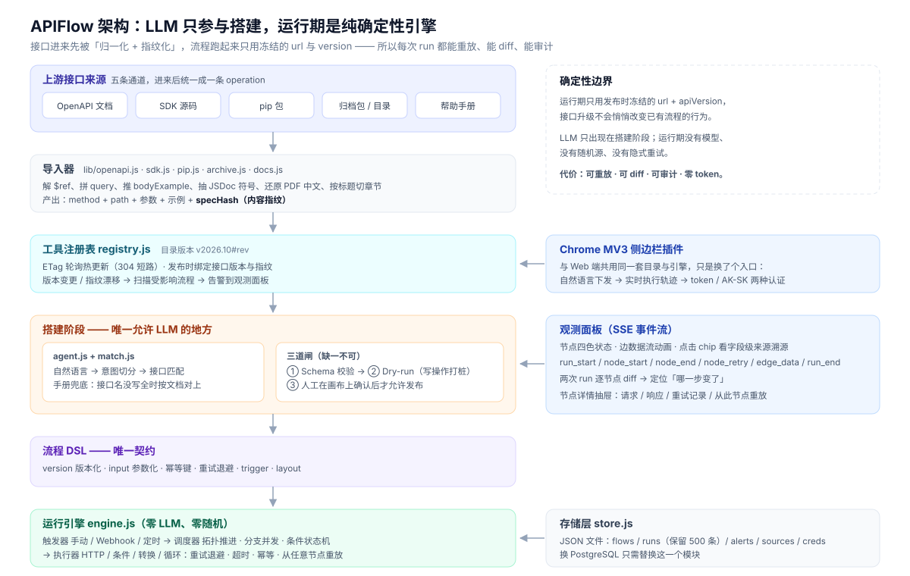
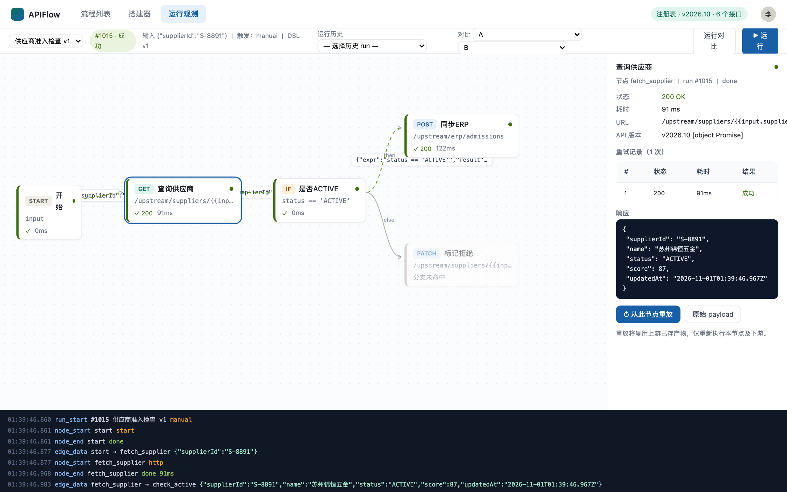
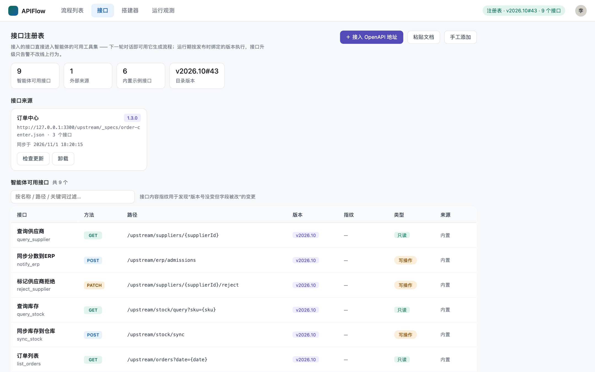

# APIFlow 平台 —— 自然语言构建可复用接口流程

[](LICENSE)


根据《APIFlow 平台系统设计图》完整实现的可运行系统。**LLM 只参与搭建，运行时是纯确定性引擎**（可重放、零 token 成本）。

<p align="center">
  
</p>

| | |
|---|---|
| **运行观测**：节点四色状态、边数据流动画、字段级来源溯源、两次 run 逐节点 diff | **接口注册表**：OpenAPI / SDK / pip / 归档 / 帮助手册五条通道接入，版本与内容指纹绑定 |
|  |  |

## 启动


```bash
node server.js          # 零依赖，Node 22+（内置 fetch / AbortController）
# → http://127.0.0.1:3300
```

## 三大系统（对应设计图五大块）

| 设计图模块 | 实现 |
|---|---|
| **搭建阶段（LLM 参与区）** | `lib/agent.js`：自然语言 → DSL 草稿；三道闸 = ① Schema 校验（`lib/dsl.js`）→ ② Dry-run（写操作自动替换为桩，只读接口真实执行）→ ③ 人工画布确认（前端 `#btnPublish` 强制校验三道闸状态） |
| **流程 DSL 唯一契约** | JSON + 校验器；`version` 版本化 / `input` 参数化（含 sample）/ 幂等键（写操作默认 `{{run.num}}-<node>`）/ 重试策略（次数 + 指数退避）/ `trigger` / `layout` 画布坐标 |
| **运行阶段（无 LLM）** | `lib/engine.js`：触发器（手动 / Webhook `/webhook/:flowId` / 定时 `interval`）→ 调度器（拓扑推进、分支并发、条件 then/else 状态机）→ 节点执行器（HTTP / 条件 / 转换 / 循环；重试退避、超时、幂等键、**从节点重放**）→ 运行历史（run = DSL 版本 + 节点 IO 全量快照） |
| **实时事件流** | SSE `/api/events`：`run_start / node_start / node_end / node_retry / edge_data / edge_skip / error / run_end`；事件同时持久化进 run 记录（可审计） |
| **观测面板** | 前端三界面：节点状态四色着色、边数据流动动画 + 数据 chip（点击看**字段级来源溯源**）、节点详情抽屉（请求/响应/重试记录/从此节点重放）、**运行对比**（两次 run 逐节点 diff）、事件日志流、接口变更告警 |
| **存储层** | `lib/store.js`：JSON 文件（`data/flows.json` / `runs.json` / `alerts.json`），保留 500 条 run；替换为 PostgreSQL 只需改此模块 |
| **工具注册表** | `lib/registry.js`：API 目录（`/upstream/_catalog` 带 ETag）、4 秒轮询热更新（304 短路）、发布时绑定接口版本 + 内容指纹、版本变更 / 指纹漂移自动扫描受影响流程 → 告警（观测面板"运行对比定位差异"） |
| **接口接入（前端 → 智能体）** | 「接口」页：接入 OpenAPI 地址 / 粘贴文档 JSON / 手工添加 → `lib/openapi.js` 解析（`$ref` 解引用、query 拼接、bodyExample 推导、**内容指纹 specHash**）→ 合并进目录 → 下一轮对话智能体即可用；`GET /upstream/_sandbox/*` 为接入接口的回显沙箱上游 |

## 接口怎么"接进"智能体

```
上游接口目录 ──ETag 轮询──▶ 工具注册表 ──每次搭建实时读取──▶ 智能体生成 DSL ──三道闸──▶ 引擎执行
                            │ 版本变化/指纹漂移 → 自动告警          （运行期只用冻结的 url + apiVersion）
```

- **生效时机**：接入后目录版本立即变化（`v2026.10#<rev>`），智能体下一轮对话即读到；运行期刻意隔离，接口升级不悄悄改变线上行为。
- **指纹漂移检测**：每个接口算 `specHash`（不含版本号），版本号没动但字段被改也能被 `checkBindings` 发现。
- **冲突保护**：operationId 与已有接口冲突时自动加来源后缀，不覆盖内置接口。

## 帮助手册（外部文档 → 搭建器的解析依据）

「接口」页可以把**公网帮助手册 / 本地文档**接进来（不会注册成可调接口）：

- **🔗 通过 URL 抓取**：填手册地址，自动顺着同一目录的子页面抓取（默认 12 页；`/` 与 `/index.html` 去重、正文过短的导航页自动丢弃）。
  - **JS 渲染页自动兜底**：静态抓取只有 SPA 空壳时，自动调用本机 Chrome 无头渲染真跑一遍 JS 再取正文（移动云帮助中心 `ecloud.10086.cn/op-help-center` 走专用适配器：接口直取目录树 + 逐章渲染，19s 抓整本 12 章）。
  - 没有 Chrome 时仍可「导入文档 → 粘贴正文」。
- **⇱ 导入文档**：`.md / .txt / .html / .pdf / .docx / .doc(RTF)`，或直接**粘贴正文**（前端渲染抓不到正文时用）。PDF 按字体对象解析 ToUnicode 还原中文（加密 / 扫描件会给出明确提示）。
- **在搭建器里怎么用**：
  - 对话回复带 **📖 手册依据**——引用命中的章节标题、原文片段与「原文」链接，解析为什么这么理解有据可查；
  - 接口名没说全时**依据手册补全**：「每周出一份告警巡检日报」这类业务话术，能对上手册章节标题指向的接口（置信度过低时降级为「建议接口」，不瞎猜）；
  - Chrome 插件端走同一套匹配器，无需额外配置。
- 存储：`data/docs.json` + `data/docs/<id>.json`（章节分块），检索为中文二元组 + 英文分词的轻量打分；手册与 SDK 资料是两套独立来源。

## API 一览

```
POST /api/agent/draft                {text}              自然语言 → 草稿（三道闸①已内置）
GET  /api/flows  /api/flows/:id/def                      流程列表 / 定义
POST /api/flows/:id/draft            {def}               画布编辑保存
POST /api/flows/:id/validate         {def}               三道闸①
POST /api/flows/:id/dry-run                              三道闸②（写操作跳过；可带 {input,runId}）
POST /api/flows/:id/autofix          {def,mode}          搭建器自动修复 / 自动断言（mode=fix|assert）
POST /api/flows/:id/publish          {def,confirm}       三道闸③（未过闸 422 拒绝）
POST /api/flows/:id/run              {input}             手动触发
POST /api/flows/batch-run            {ids,concurrency,input}  多流程并行批跑（202 受理，后台并发执行）
GET  /api/batches  /api/batches/:id                      批跑列表 / 进度（含峰值并发与加速比）
POST /api/batches/:id/cancel                              停止批跑中未开始的流程
POST /api/flows/batch-delete          {ids}               批量删除流程（含运行历史）
POST /api/sources/batch-delete        {ids}               批量卸载接口来源
POST /api/ops/batch-delete            {ids,preview}       批量删除注册表接口（preview=true 只出报告；内置→隐藏可恢复，来源接口→移除）
POST /api/ops/restore                 {ids?}              恢复被隐藏的内置接口（缺省全部恢复）
POST /webhook/:flowId                                    Webhook 触发
GET  /api/runs?flowId=  /api/runs/:id                    运行历史 / 详情
POST /api/runs/:id/replay            {fromNode}          从节点重放（复用上游产物）
GET  /api/runs/:a/diff/:b                                运行对比（逐节点 diff）
GET  /api/events                                         SSE 实时事件流
GET  /api/catalog  /api/alerts                           注册表 / 告警
GET  /api/sources                                        接口来源列表
POST /api/sources                    {mode:url|text|manual|sdk|pip}  接入 OpenAPI / 粘贴文档 / 手工添加 / 导入 SDK / pip 安装导入
POST /api/sources（sdk）             {files|url|text, autoSync}  SDK 源码自动分析出接口清单
POST /api/sources/:id/refresh                            重新拉取并解析（返回 added/changed/removed，SDK/文档通用）
POST /api/sources/:id/autosync       {enabled,intervalMs} 现网自动更新开关（1 分钟 ~ 24 小时）
DELETE /api/sources/:id                                  卸载来源（目录即时还原，SDK 源码一并清理）
POST /api/admin/catalog-bump                             模拟接口升级（演示告警）
POST /api/auth/token                 {ak,sk,name}        AK/SK 换取访问令牌（默认 7 天，可撤销）
GET  /api/auth/me                                        令牌自述身份
GET/POST /api/access/settings                            强制认证开关 / 令牌列表与调用活动
DELETE /api/access/tokens/:id                            撤销令牌
GET  /api/ext/ping  /api/ext/bootstrap                   插件探活 / 启动数据（不参与强制认证）
POST /api/agent/plan  /api/agent/execute                 自然语言 → 计划 / 执行（插件对话入口）
POST /api/ops/:id/debug                                  单接口调试（与流程共用引擎）
GET  /api/docs                                           帮助手册列表 / 统计
POST /api/docs                       {mode:url|text}     URL 抓取（顺目录多页）/ 粘贴正文
POST /api/docs/upload?name=                              上传 .md/.txt/.html/.pdf/.docx/.doc（二进制体）
GET  /api/docs/search?q=                                 手册全文检索（可 docId 限定单篇）
GET  /api/docs/:id                                       章节预览 / 篇内检索
POST /api/docs/:id/refresh                              URL 型手册重新抓取
DELETE /api/docs/:id                                     删除手册
```

## 搭建器调试（自动修复 · 自动断言 · 实时数据流）

在搭建器右侧抽屉对草稿做全链路调试：

- **🛠 自动修复**：静态扫描草稿并直接修好结构问题——悬空边、缺 start / start 出边数不对、条件缺 then/else 分支（自动补桩）、不可达节点（接入主链）、写操作重试 >1 缺幂等键、缺 method/url（按注册表补全）、路径参数未填（用输入示例填充）、布局缺失；修不了的逐条给出人工处理提示。API：`POST /api/flows/:id/autofix`（`lib/autofix.js`）。
- **✓ 自动断言**：按注册表 `expect` 字段一键给 HTTP 节点加断言（默认校验 2xx，内置接口额外校验输出字段）；断言也可在节点属性里手工配置（状态码列表 / 输出字段 / 表达式），节点带 ✓A 徽标。
- **断言引擎**：运行期对真实响应做确定性校验（`lib/assert.js`），失败节点标红、run 失败、事件流发 `assert_fail`；调试阶段断言不过会被第二道闸拦截（不能发布）。
- **▶ 调试运行**：Dry-run + 实时 SSE——画布节点四色着色、边上实时显示流动的中间数据（点击可字段溯源）、抽屉底部实时事件日志；支持自定义调试输入（JSON）；调试产物（输出 / 断言失败详情）点击节点即可查看。

## 画布手动编辑（不止自然语言，也能上手改）

搭建器画布左上角的工具栏支持对草稿做结构性修改，与自然语言描述混用：

- **＋ 添加接口**：弹出接口选择器（可搜索 165 个已接入接口），选中即生成 HTTP 节点——自动接到当前链尾，写操作自动预置幂等键，缺参数的接口会提示要补什么。没有草稿时点它会先创建一个带「开始」节点的空白骨架，从零手搭也行（**Blank 新建空白**）。
- **⇄ 连线**：进入连线模式后「点起点 → 点终点」即建边；条件节点的两条出边自动标记 `then` / `else`（最多两个分支）；Esc 退出。
- **删除**：节点右上角 ✕ 删除节点（相关连线一并移除；有下游 `{{nodes.x…}}` 引用时会先警告数量）；连线中点的 ✕ 删除单条连线。开始节点不可删。
- **节点属性**：点节点在右侧面板改名称 / 方法 / URL / **Body（JSON）** / 重试 / 幂等键 / 断言；URL 与 Body 里可写 `{{input.x}}`（流程输入）或 `{{nodes.节点id.output.字段}}`（上游输出）。
- 所有结构性改动**自动保存草稿**（防抖 600ms），保存后第二道闸（Dry-run）重置为未执行——结构变了旧结果不算数，发布前需重跑。UI 回归：`node test-canvas-edit.js`。

## 业务错误信封与参数提示（200 里的错误不再装成功）

很多网关把业务错误包在 HTTP 200 里返回，比如移动云 OpenAPI：

```json
{"code":"010024","message":"参数校验异常,poolId","state":"ERROR"}
```

不识别的话，节点会绿灯通过、流程「成功」结束、下游拿到一坨错误 JSON。平台现在做了三层：

- **信封识别**（`lib/bizerr.js`）：HTTP 200 且响应体是错误信封（`state: ERROR` / `success: false` / 非 0 的 `code` + `message`）时，节点标红、流程判失败；`参数校验异常,poolId` / `Input parameter AccessKey missing` / `不支持该产品类型:ecs` 这类消息会被解析成「缺少必填参数 poolId（资源池 ID）」「认证参数缺失」「参数 productType 不接受取值 ecs」这样的可执行提示。正常响应（成功信封、普通业务对象）不会误判。
- **参数候选**（`lib/paramhint.js`）：SDK 生成的客户端方法往往只有一个 `xxx_request` 参数，真正的 query 字段藏在 `model/<op>_query.py` 的 setter 里。导入 SDK 时顺带从资料库抽出 `<Op>Query` 类字段，节点属性面板的 Query 区给出「可加参数」候选（中文名 + 必填徽标 + 学到的示例值），点一下即加一行。
- **参数学习**（`data/paramhints.json`）：网关校验是「一个参数一个参数地报」——先报 poolId，补了再报 productType。每次报错把缺参记为该接口的必填项，跑通后把取值记成示例；下一次用自然语言搭同一条流程时会自动带上（「资源池：CIDR-XX」这类描述也会被抽成 poolId 取值）。`DELETE /api/ops/:id/params` 可清空某接口学到的提示。

回归：`bash test-params.sh`（10 项：信封识别单元 / Query 字段抽取 / 槽位抽取 / 200+错误判失败 / 逐参学习 / 参数接口 / 坏取值提示 / 清理）。

## 多流程并行执行

流程列表页勾选多个已发布流程 →「▶▶ 并行执行」→ 设定并发度（2~8）→ 一键同时开跑：

- **受限并发池**：`lib/batch.js` 的 BatchRunner 按并发度用共享游标的 worker 池调度，同一时刻最多 N 个流程在跑，其余排队；并发度 1 即退化为严格串行。
- **实时进度**：弹窗内逐流程显示状态（排队/运行中/成功/失败/已取消）、耗时与 run 编号，汇总卡给出完成数、墙钟耗时与**并行加速比**（各流程耗时之和 ÷ 墙钟）；列表页顶部有可收起的进度条横幅，关掉弹窗后台继续跑。
- **可取消**：正在跑的流程不中断（避免写操作半途留下脏数据），未开始的直接取消，批次状态经 `cancelling` 收敛到 `cancelled`。
- **完整可观测**：每个批跑 run 以 `trigger=batch` 写入运行历史，事件流 / 重放 / 运行对比全部可用；单流程内部的分支并行由引擎的边推进（Promise.all）天然支持。
- 工程细节：并行时运行记录落盘做合并写（150ms 去抖，结束态立即落盘），避免多个流程同时高频全量写 `runs.json` 拖慢事件循环。
- 测试：`bash test-batch.sh`（33 项：真并发/峰值控制/串行退化/取消/未发布与不存在流程/参数校验/记录完整性）。

## SDK 导入（自动分析接口）与现网自动更新

不想再维护一份 OpenAPI？直接把现成的客户端 SDK 变成接口清单 ——「接口」页 →「⇱ 导入 SDK」，三种导入方式：**上传文件 / 给 SDK 地址 / 粘贴代码或配置 JSON**：

- **源码自动分析**（`lib/sdk.js`）：扫描源码里的 HTTP 调用点（method + path），抽注释里的中文说明当接口名与关键词：
  - TypeScript / JavaScript：`this.request('GET', \`/orders/${id}\`)`、`axios.get('/orders/' + id)`
  - Python：`self._request("GET", f"/orders/{order_no}")`、`requests.get(...)`、FastAPI 装饰器
  - Java：Retrofit `@GET("orders/{id}")`、Spring `@GetMapping`
  - Go：`http.NewRequest("GET", "/orders/"+id)`、`fmt.Sprintf("/stock/%s/sync", sku)`
  - 配置 JSON：`{"operations":[…]}`（也接受多文件清单 `{"files":["a.ts","https://…/b.py"]}`）
  - 各种拼接写法统一归一化成 `/orders/{orderNo}` 路径参数形式；同一来源可混合多语言文件并按指纹去重
- **源码落盘**：导入的 SDK 存到 `data/sdk/<来源id>/`，本地上传的也能随时「重新解析」；卸载来源时一并清理
- **pip 安装导入**：第四种方式「pip 安装」—— 直接填 PyPI 包名（如 `stripe==11.4.1`，也支持 `[extra]`、`>=`、git+https、私有源），服务端真实执行一次 `pip install --target <临时目录>`，从装好的包里筛出带 HTTP 调用的源码文件交给同一个解析器：
  - 两步交互：先「安装并分析」看识别结果（包元数据 / 服务地址 / 接口列表），再确认导入，分析结果缓存 10 分钟不重复装包
  - 默认 `--no-deps` 只装包自身（可选「连同依赖」）；并发上限 2；单文件 2MB / 送解析总量 6MB 上限
  - 自动读取 `.dist-info/METADATA`：包名、版本、摘要、License 直接作为来源信息；`DEFAULT_API_BASE` 这类常量用于识别服务地址
  - 包名校验 + `execFile` 参数数组执行，杜绝命令注入；不存在的包 / 无 HTTP 调用的包 / 需要本地编译的包都给出可行动的提示
  - pip 来源同样支持「重新安装」（refresh 可带 `{spec:"stripe==12.0.0"}` 升级重装）与现网自动更新
- **现网自动更新**：来源开启 autoSync 后，服务端每 15s 扫描、到点（1 分钟 ~ 24 小时可设）自动重新拉取并解析；差异（新增/变更/移除）实时回写来源卡片，SSE 推送提示，接口内容变更自动触发版本漂移告警；失败原因记录在来源上
- SDK 接口指纹包含说明文字 —— 现网 SDK 常常只改注释里的字段说明，也会被判定为内容变更
- 测试：`bash test-sdk.sh`（19 项：五种语言解析 / 混合导入 / 现网差异 / 调度器真实执行 / 参数校验 / 卸载清理）

## SDK 资料库（函数 / 方法 / 类，不只是接口）

导入 SDK 时（压缩包 / 文件夹 / pip / 文件），除接口清单外还会把**整个包里的类、方法、函数、类型定义**抽成可检索的「资料」：
`lib/materials.js` 做多语言浅解析（Python docstring / TS-JSDoc / Java javadoc / Go 注释），落盘 `data/materials/<来源id>.json`。

- **基础库也能导入（仅资料模式）**：像 `ecloudsdkcore` 这类 client 封装 / 鉴权 / 序列化的框架包本来就没有业务接口——只要抽到了类和函数，照样可以导入：来源卡片显示「仅资料（无业务接口）」，资料（如 46 类 / 85 方法 / 41 函数）全部入库供智能体引用。只有「既没有接口也没有符号」的空包才会被拒绝。
- **检索**：「接口」页来源卡片 →「📚 资料」打开检索面板；`GET /api/materials?q=`（全局，中英文都可）、`GET /api/sources/:id/materials`（单来源，支持 kind 过滤与分页）
- **智能体引用**：搭建器对话会自动附上与描述相关的资料（如「查一下实例的密钥对」→ `Client.create_key_pair` 的签名与参数说明）；没识别出接口时也会给出相关资料，而不是只报错
- 压缩包导入按**解压后的全部源码**建资料（含未挑中的 model / 工具函数）；重新解析时资料随源码重建（压缩包来源保留首次全量扫描结果，不缩水）
- 卸载来源时资料一并清理；启动时自动清孤儿资料文件
- 测试：`bash test-materials.sh`（9 项：files/压缩包导入建资料、中英文检索、类型过滤分页、refresh 不缩水、智能体引用、卸载清理、幂等卸载）

## 接口注册表批量删除

「智能体可用接口」表每行带勾选框，支持批量删除，删除前先预览再确认：

- **两种删除语义**：内置接口 → 从注册表**隐藏**（记入 `data/ops.json`，随时「↺ 恢复隐藏接口」一键找回）；来源接口 → 从所属来源中**移除**，来源被删空时自动一并移除。
- **删除前预警**：预览接口返回会受影响的流程清单（已发布排前、同名草稿合并计数），确认弹窗里明示「删除后再运行会失败」；同时提示将被清空的来源。
- **连带清理**：删除接口自动解绑其单接口凭证绑定（凭证本体保留）、清理指向它的变更告警；目录版本与 ETag 同步变化（版本带 `.h<水位>` 后缀）。
- 接口删除后立即从注册表、智能体工具集、自动修复候选中消失；已发布流程的历史运行与版本绑定不受影响。
- 测试：`bash test-ops.sh`（16 项：预览不改状态 / 隐藏与恢复 / 来源逐个移除 / 引用预警 / 凭证解绑 / 参数校验 / 幂等）。

## 认证（AK / SK）

凭证支持两级作用域，**单接口绑定优先于流程级**：

- **单接口级**：接口页操作表「认证」列，把某个接口绑定到凭证 —— 运行该接口的节点自动注入认证头。
- **流程级**：流程列表右侧面板「接口认证（流程级）」，对该流程内所有未单独绑定的接口生效。
- 凭证 API：`GET/POST /api/creds`、`POST /api/creds/bind-op`（单接口绑定）、`DELETE /api/creds/:id`、`POST /api/flows/:id/auth`（流程级绑定）。
- 两种模式：**HMAC 签名**（默认，规范串 `METHOD\npath?query\ntimestamp\nsha256hex(body)`，HMAC-SHA256，时间戳 ±5 分钟防重放）与**头直传**（AK/SK 直接放请求头，仅限内网）。
- SK 安全：仅创建时一次性完整返回，列表永远掩码，运行记录落库前脱敏；删除凭证自动清理两级绑定。
- 演示：内置受保护接口「受保护数据」（`/upstream/secure/data`），未绑定凭证运行会 401 失败，绑定后成功。
- 测试：`bash test-auth.sh`（23 项：凭证 CRUD / 签名校验 / 两级绑定优先级 / SK 脱敏 / 删除清理）。

## Chrome 插件（插件端接入）

`extension/` 是一个 Chrome MV3 侧边栏插件，**直接共用平台同一份数据**（流程、接口注册表、运行记录），不是复制：插件里的执行就是平台里的执行，Web 端与插件端看到的是同一份运行历史与事件流。

- **加载**：Chrome → `chrome://extensions` → 开发者模式 →「加载已解压的扩展程序」→ 选 `extension/` 目录；点工具栏图标打开侧边栏。
- **自然语言执行**：对话页输入「调试查询库存 SKU-02」「运行供应商准入检查」「新建一个流程：…」「最近失败的运行」——确定性意图路由（`lib/intent.js`）分派为调试单接口 / 运行流程 / 生成草稿 / 平台查询；写操作先出请求预览、点「确认执行」才真正发出。
- **实时观测**：对话页内嵌执行轨迹（节点状态 / 重试 / 事件流，节点可展开看请求响应）；「流程」页签浏览与触发已发布流程；「观测」页签看全平台最近运行，点开即看节点详情——与 Web 端观测面板同一数据源。
- **认证双通道**（默认与平台一致：不开认证时插件直连可用）：
  - **令牌**：`POST /api/auth/token` 用 AK/SK 换 `apf_` 前缀 Bearer 令牌（SHA-256 哈希落库，默认 7 天，可撤销），插件设置抽屉一键换取；
  - **AK/SK 直签**：规范串 `METHOD\npath?query\nts\nsha256hex(body)` HMAC-SHA256（WebCrypto 实现，与 `lib/auth.js` 同一套规范），头 `x-api-key / x-sign-ts / x-signature`。
- **自愈**：平台未开认证时，客户端残留的失效令牌不拦截请求——服务端降级放行并打 `x-apiflow-auth: invalid` 响应头，插件/Web 端据此清掉脏令牌；开了认证则一律 401 并提示换取令牌。
- **Web 端管理**：平台顶栏「🧩 插件接入」面板可签发/撤销令牌、开关强制认证、查看调用活动；运行记录的 `actor` 字段标识每次执行来自谁（如「插件 · 令牌」「xxx · AK/SK」「本机控制台」）。
- 测试：`bash test-extension.sh`（63 项：默认开放直连 / 四类意图 / 执行与 428 确认闸门 / 观测与 actor / 令牌换发与撤销 / AK-SK 直签 / 强制认证与降级放行 / 清理归位）；UI 自动化覆盖对话执行、流程、观测、写操作确认、双主题。

## 模拟上游

- 内置 6 个接口操作（`/upstream/*`）：查询供应商、同步 ERP、标记拒绝、查询库存、同步仓库、订单列表 —— 流程对它们发起真实 HTTP 调用。
- `GET /upstream/_specs/<file>`：`fixtures/` 里的示例 OpenAPI 文档（试接入用：`order-center.json`，3 个接口）。
- `ANY /upstream/_sandbox/*`：接入接口的回显沙箱，新接入的接口不做任何配置即可真实跑通。

## 测试

```bash
bash test-e2e.sh        # 14 项后端全链路回归（重放/diff/告警/SSE/循环/Query/定时落库）
bash test-sources.sh    # 9 项接口接入回归（URL/粘贴/手工/冲突后缀/指纹漂移检测/卸载还原）
bash test-auth.sh       # 23 项认证回归（凭证 CRUD/签名/两级绑定/脱敏）
bash test-debug.sh      # 26 项搭建器调试回归（自动修复/自动断言/调试运行/断言引擎）
bash test-batch.sh      # 33 项多流程并行执行回归（并发池/上限/取消/校验/记录）
bash test-ops.sh        # 16 项接口注册表批量删除回归（预览/隐藏恢复/来源移除/解绑/校验）
bash test-sdk.sh        # 19 项 SDK 导入回归（五语言解析/混合导入/现网差异/自动同步调度）
bash test-pip.sh        # 11 项 pip 安装导入回归（包名校验/装包分析/两步导入/换版本重装/卸载清理）
bash test-archive.sh    # 12 项压缩包/文件夹导入回归（zip/tar.gz 解压/噪声跳过/token 两步/真实 SDK 包）
bash test-materials.sh  # 9 项 SDK 资料库回归（符号抽取/中英文检索/类型过滤/智能体引用/卸载清理）
bash test-extension.sh  # 65 项 Chrome 插件接入回归（默认开放/四类意图/执行闸门/令牌/AK-SK/强制认证/降级自愈）
bash test-params.sh     # 10 项参数提示回归（200 业务错误信封/缺参提取/参数学习/自动带参）
node test-canvas-edit.js # 画布手动编辑 UI 回归（27 项；需 playwright + 本机 Chrome）
node test-ui.js         # 前端三界面自动化（需 playwright；NODE_PATH 指向 node_modules）
node test-sources-ui.js # 前端「接口接入」链路自动化（空态→接入→注册表→搭建器可用）
```

最近一轮：**自然语言 20 + 帮助手册 21 + 全链路 e2e 14 + 参数提示 10 + Chrome 插件 65 + 认证 29 + 注册表批量删除 16 + pip 11 + SDK 导入 21 + 压缩包 12 + 调试 26 + 资料库 9 + 接入 9 + 画布编辑 27 全部通过（共 290 项；并行批跑需 ≥4 条已发布流程另测）。测试套件已全部「种子自保障」：不依赖平台里的用户数据，自建夹具、退出自动清理还原。**

## 设计对齐说明

- 「转换 JQ」实现为轻量表达式转换（取值/组装/映射），循环节点为 `over + 嵌入式 HTTP 请求` 形态；如需完整 JQ 可替换 `renderDeep`。
- NL 解析为确定性规则实现（意图切分 + 目录关键词匹配 + 中式比较符映射），**接入真实 LLM 只需替换 `lib/agent.js` 的 `buildDraft`**，三道闸机制不变。
- 演示目录版本变更：`POST /api/admin/catalog-bump`（v2026.10 → v2026.11），告警出现在流程列表页。

## 安全与隐私

所有数据都在本机 `data/` 目录，不上传任何服务端。`data/creds.json` 里的 AK/SK 是**明文**，`data/runs.json` 是请求响应全量快照——这两处已列入 `.gitignore`，任何情况下不要提交。部署建议（不要直接暴露公网、凭证轮换、存储层替换）见 [SECURITY.md](SECURITY.md)。

## 贡献

欢迎提 Issue 与 PR。提交前请读 [CONTRIBUTING.md](CONTRIBUTING.md)（提交信息格式、回归要求、以及本项目的一条底线：运行期不引入 LLM、随机与隐式重试）。问题模板在 [.github/ISSUE_TEMPLATE](.github/ISSUE_TEMPLATE/)。

## License

[MIT](LICENSE) © 2026 lijishuang

